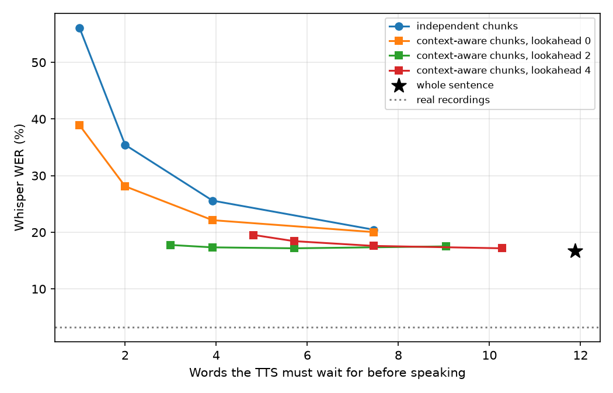

# TTS for voice agents: speaking before the sentence is finished

Turino, 2026-10-19 (Australia/Brisbane). Model: TTS_0.10 arm R0 at 40,000 steps. Measurements
on one RTX 4070 Ti SUPER; intelligibility by Whisper medium (`tools/asr_wer.py`). Since
2026-10-20 this is the project's direction; this page records what has been measured for it.

## The problem

A voice agent answers in three stages: speech recognition turns the user's speech into text, a
language model writes the answer, and a TTS speaks it. The language model produces its answer
word by word. A TTS that needs a whole sentence can start only when the language model has
finished that sentence; the 100 held-out LJSpeech sentences have about 12 words on average. To speak
earlier, the TTS must synthesize a few words at a time, but each piece then lacks the rest of
the sentence, which can make it harder to understand.

**Question:** how few words can the TTS wait for and still be as intelligible as when it
synthesizes the whole sentence?

## How it is measured

The chunk study (`tools/chunk_study.py`) synthesizes each of the 100 held-out sentences
(never trained on) under 17 conditions, with the same random seed per sentence:

| Condition | What the TTS gets | Words it must wait for before speaking |
|---|---|---|
| whole sentence | the complete sentence, one call | the whole sentence (about 12) |
| independent N-word chunks (`naive_N`) | each N-word chunk on its own; the pieces' audio is concatenated | N |
| context-aware N-word chunks, lookahead K (`ctx_N_kK`) | all previous words + the chunk + the next K words; only the chunk is voiced | N + K |

Example, "The quick brown fox jumps over the lazy dog.", context-aware 2-word chunks with
lookahead 2: the first call reads "The quick brown fox" and voices "The quick"; the second reads
"The quick brown fox jumps over" and voices "brown fox"; and so on. Technically the text encoder
sees the longer text, and the durations of all characters outside the chunk are set to zero, so
only the chunk receives audio frames.

Each condition's audio is transcribed by Whisper medium with the project's locked protocol;
the word error rate (WER) is a corpus rate over the 100 sentences. The LJSpeech recordings of
the same sentences score 3.3%, the floor set by Whisper itself. Differences between conditions
or checkpoints come with 95% intervals from 2,000 paired bootstrap resamples of the sentences
(`tools/chunk_analysis.py`).

## Results for R0

| Condition | Words waited for | Whisper WER | Difference from whole sentence [95% CI] | Duration vs recording |
|---|---:|---:|---:|---:|
| whole sentence | 11.9 | 16.7% | – | 0.96 |
| independent 1-word chunks | 1.0 | 56.1% | +39.4 [+34.6, +44.0] | 1.31 |
| independent 2-word chunks | 2.0 | 35.4% | +18.7 [+14.0, +23.7] | 1.13 |
| independent 4-word chunks | 3.9 | 25.6% | +8.9 [+5.0, +12.7] | 1.02 |
| independent 8-word chunks | 7.5 | 20.5% | +3.8 [+0.9, +6.8] | 0.98 |
| context-aware 2-word chunks, no lookahead | 2.0 | 28.1% | +11.4 [+7.7, +15.3] | 1.11 |
| context-aware 1-word chunks, lookahead 2 | 3.0 | 17.8% | +1.1 [−2.3, +4.1] | 0.96 |
| context-aware 2-word chunks, lookahead 2 | 3.9 | 17.3% | +0.6 [−2.1, +3.3] | 0.96 |
| context-aware 4-word chunks, lookahead 2 | 5.7 | 17.2% | +0.5 [−2.1, +3.1] | 0.96 |
| LJSpeech recordings | – | 3.3% | – | 1 |

All 17 conditions: [`records/chunk-study/R0_40k/analysis.json`](records/chunk-study/R0_40k/analysis.json).



What the numbers show:

1. **Chunks synthesized on their own are much harder to understand.** Two-word chunks raise the
   WER from 16.7% to 35.4% and stretch the speech to 1.13× the recording's duration.
2. **Two words of lookahead remove that cost within the precision of this test.** Context-aware
   chunks of one or two words with lookahead 2 are not distinguishable from whole sentences
   (intervals include 0) while waiting for 3–4 words instead of 11.9.
3. **The lookahead matters more than the left context.** Two-word chunks with all previous words
   but no lookahead still score 28.1%.
4. **At equal waiting, context helps.** Context-aware 2-word chunks with lookahead 2 and
   independent 4-word chunks both wait for about 3.9 words: 17.3% against 25.6%, a difference of
   −8.2 points [−11.6, −5.0].
5. **Synthesis is not the bottleneck.** One chunk takes about 11 ms on the RTX 4070 Ti SUPER and
   about 60 ms on 8 CPU threads; a whole sentence 24 ms and 239 ms.

## Chunk-aware fine-tuning

Context-aware chunks need the next words and a modified inference path. The alternative studied
next is to teach the model short pieces directly: fine-tune R0 on training clips cut at word
boundaries ([CHUNK_FINETUNE.md](CHUNK_FINETUNE.md)). A local check trained R0 5,000 more steps
with this cutting and, as a control, 5,000 more steps without it, and ran the same chunk study
on both:

| Condition | Words waited for | R0 | control +5k | chunk-trained +5k | chunk − control [95% CI] |
|---|---:|---:|---:|---:|---:|
| whole sentence | 11.9 | 16.7% | 16.6% | 15.4% | −1.2 [−3.8, +1.4] |
| independent 1-word chunks | 1.0 | 56.1% | 56.9% | 36.3% | −20.6 [−25.5, −15.7] |
| independent 2-word chunks | 2.0 | 35.4% | 34.1% | 24.2% | −9.9 [−14.5, −5.2] |
| independent 4-word chunks | 3.9 | 25.6% | 20.4% | 16.1% | −4.3 [−7.9, −0.9] |
| context-aware 2-word chunks, no lookahead | 2.0 | 28.1% | 28.4% | 20.6% | −7.7 [−12.0, −4.3] |
| context-aware 2-word chunks, lookahead 2 | 3.9 | 17.3% | 16.0% | 16.4% | +0.4 [−2.7, +3.5] |

- Chunk-aware training helps exactly where the model lacks the rest of the sentence: chunks
  without lookahead became much easier to understand, while the control (the same extra steps
  without cutting) did not improve them.
- With two words of lookahead the conditions were already close to whole sentences, and the
  fine-tuning made no detectable difference there.
- Whole-sentence intelligibility did not change detectably.
- The chunk-trained model's independent 4-word chunks (16.1%) are as intelligible as R0's whole
  sentences (16.7%), with no lookahead and the plain inference path.
- Side effect: its speech is faster (short chunks 0.81–0.89× the recording's duration, whole
  sentences 0.92×); not yet checked by listening.

One seed per run and 5,000 steps; the full-size runs (20,000 steps, with checkpoints at 5k for
replication) are described in [CHUNK_FINETUNE_RUNBOOK.md](CHUNK_FINETUNE_RUNBOOK.md).

## What this does not show

- No language model or speech recognizer is in the loop. "Words waited for" stands in for
  latency; no end-to-end delay has been measured.
- Whisper WER measures intelligibility only, not naturalness. Audible joins between chunks and
  prosody across chunk boundaries have not been measured, and there has been no listening test.
- One speaker (LJSpeech), one checkpoint family (R0 at 40,000 steps and two 5,000-step
  fine-tunes of it), 100 sentences, one synthesis per sentence and condition.
- Chunks are cut by word count, not at phrase boundaries.

## Reproduce

```sh
python tools/chunk_study.py --checkpoint <run>/checkpoints/vits_step_40000.pt \
    --data-dir /data/LJSpeech-1.1 --out output/chunk-study/R0_40k
python tools/asr_wer.py output/chunk-study/R0_40k --model medium
python tools/chunk_analysis.py analyze output/chunk-study/R0_40k
```

`tools/chunk_study.py` reproduces the WAVs of the recorded R0 study bit for bit (checked on 3
sentences × 17 conditions); `analyze` reproduces its `analysis.json` exactly. Whisper takes about
7 s per utterance on a 12-core CPU, so the 1,800 utterances of one study take about 3.5 hours.
To compare checkpoints sentence by sentence: `tools/chunk_analysis.py compare --study R0=<dir>
other=<dir> --out comparison.json`.

## Team decisions

On 2026-10-20 Turino moved the project to this direction. Which configuration an application
would use is still for the team to decide.
